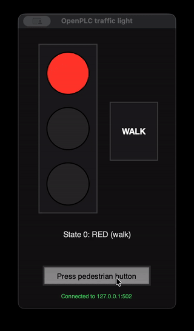
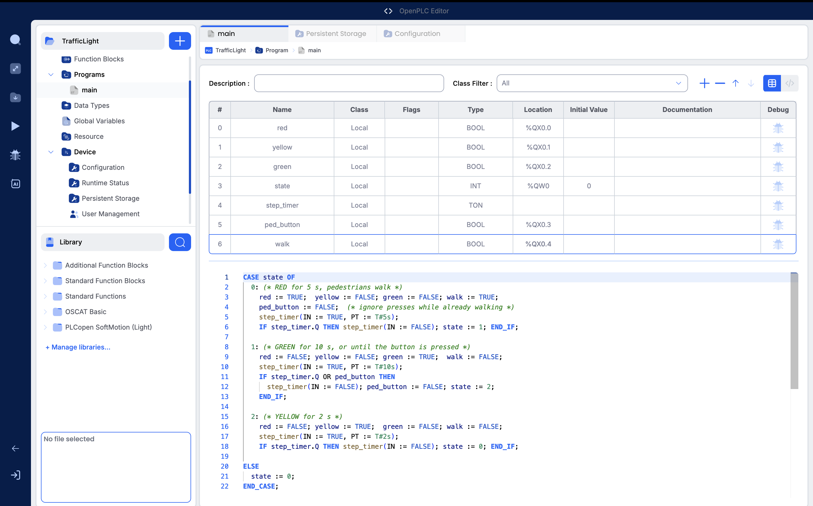
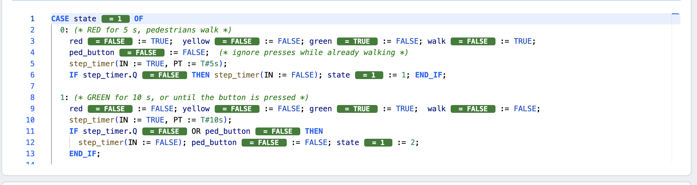
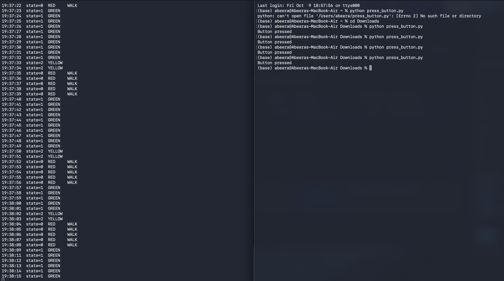
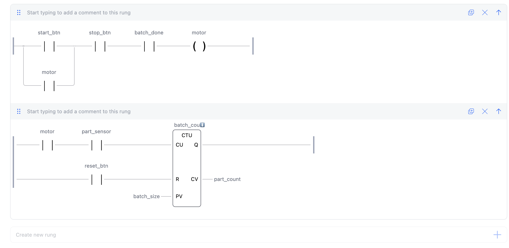
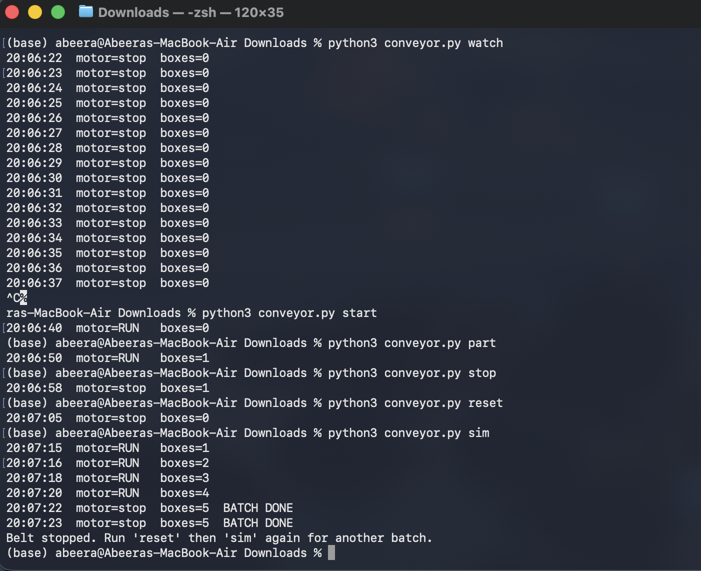
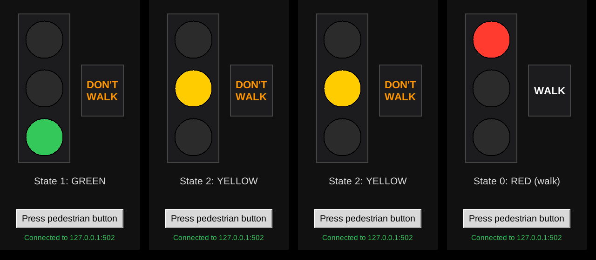

# OpenPLC on macOS: traffic light and conveyor, driven from Python

CODESYS only runs on Windows, so this project does the same PLC work on a Mac with
**OpenPLC**, which is free and open source. The OpenPLC Editor runs natively on macOS,
the OpenPLC Runtime runs in Docker, and Python talks to the PLC over **Modbus TCP**.

It contains two PLC programs written in the standard IEC 61131-3 languages:

- **Traffic light** in Structured Text (ST), with a pedestrian button and a walk light.
- **Conveyor belt** in Ladder Logic (LD), with start/stop seal-in and a box counter that stops after a batch of 5.

Each one is read and controlled from Python, and there is a live desktop dashboard for the traffic light.



## What's in here

| Folder | What it is |
|---|---|
| [`traffic-light/`](traffic-light) | ST programs (`traffic_light.st`, `traffic_light_button.st`), `read_lights.py` to watch the lights, `press_button.py` to press the pedestrian button |
| [`conveyor/`](conveyor) | Step-by-step ladder logic guide (`ladder_steps.md`) and `conveyor.py` to start, stop, feed boxes and simulate a batch |
| [`dashboard/`](dashboard) | `dashboard.py`, a Tkinter window showing the lights live with a button for the pedestrian crossing |
| [`cheat-sheet/`](cheat-sheet) | How to bring everything back up after a reboot, plus quick fixes |

## How it fits together

```
OpenPLC Editor (macOS)  --upload-->  OpenPLC Runtime (Docker, port 8443)
                                           |
                                     Modbus TCP :502
                                           |
                              Python scripts / dashboard
```

## Setup (macOS)

**1. Install the tools**

- [Docker Desktop](https://www.docker.com/products/docker-desktop/)
- [OpenPLC Editor](https://autonomylogic.com/) (v4)
- Python 3, then `pip install -r requirements.txt`

**2. Start the OpenPLC Runtime in Docker**

```bash
docker run -d --name openplc-runtime \
  -p 8443:8443 -p 502:502 \
  -v openplc-runtime-data:/var/run/runtime \
  ghcr.io/autonomy-logic/openplc-runtime:latest
```

After the first time, `docker start openplc-runtime` is enough.

**3. Load a program**

1. In OpenPLC Editor, create a project and paste in a program:
   - Traffic light: follow the comments at the top of [`traffic-light/traffic_light_button.st`](traffic-light/traffic_light_button.st) (variable table, then code body).
   - Conveyor: follow [`conveyor/ladder_steps.md`](conveyor/ladder_steps.md).
2. In **Device > Configuration**, target the OpenPLC Runtime v4 at `127.0.0.1`, port `8443`.
3. Enable the **Modbus TCP** server on port `502` under **Servers**.
4. Upload the program and start the PLC.

The runtime holds one program at a time, so upload whichever one you want to run.

**4. Run the Python side**

```bash
# Traffic light
python traffic-light/read_lights.py      # prints the lights every second
python traffic-light/press_button.py     # while GREEN: cuts green short
python dashboard/dashboard.py            # live window with a button

# Conveyor
python conveyor/conveyor.py watch        # live status
python conveyor/conveyor.py sim          # start the belt and feed boxes until the batch is done
```

## Modbus map

| Program | Modbus address | PLC variable | Meaning |
|---|---|---|---|
| Traffic light | coil 0 / 1 / 2 | `%QX0.0` / `%QX0.1` / `%QX0.2` | red / yellow / green |
| Traffic light | coil 3 | `%QX0.3` | pedestrian button (Python writes) |
| Traffic light | coil 4 | `%QX0.4` | walk light |
| Traffic light | holding register 0 | `%QW0` | state: 0 red, 1 green, 2 yellow |
| Conveyor | coils 8 to 11 | `%QX1.0` to `%QX1.3` | start, stop, part sensor, reset (Python writes) |
| Conveyor | coil 12 / 13 | `%QX1.4` / `%QX1.5` | motor / batch done |
| Conveyor | holding register 1 | `%QW1` | part count |

## Screenshots

**Traffic light program in OpenPLC Editor (Structured Text)**



**Live debug view in the editor**



**Reading the lights and pressing the pedestrian button from Python**



**Conveyor in ladder logic**



**Driving the conveyor from Python: a batch of 5 boxes stops the belt**



**Dashboard**



## Troubleshooting

- **Python says "Could not connect"**: the PLC isn't started, or the Modbus server isn't enabled on port 502.
- **Editor buttons are greyed out**: stop the simulator first.
- **"Unknown program type ... in program instance"**: in **Resource > Instances**, set the Program column to your POU name.

More in [`cheat-sheet/openplc-restart.md`](cheat-sheet/openplc-restart.md).
